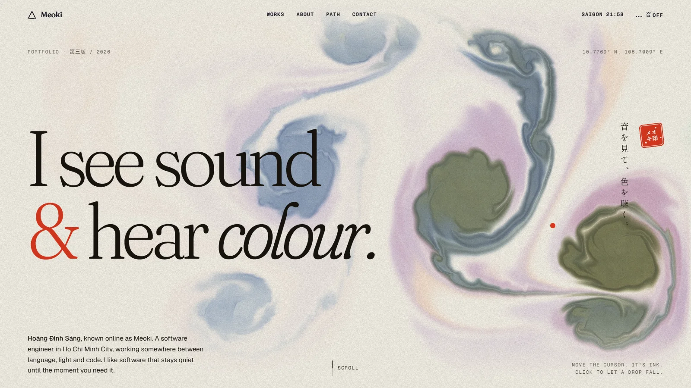
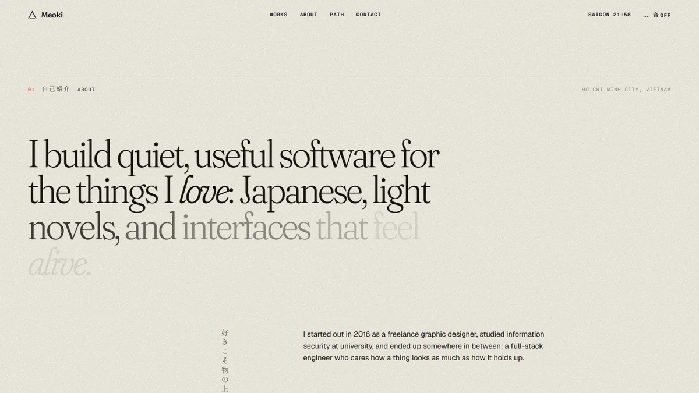
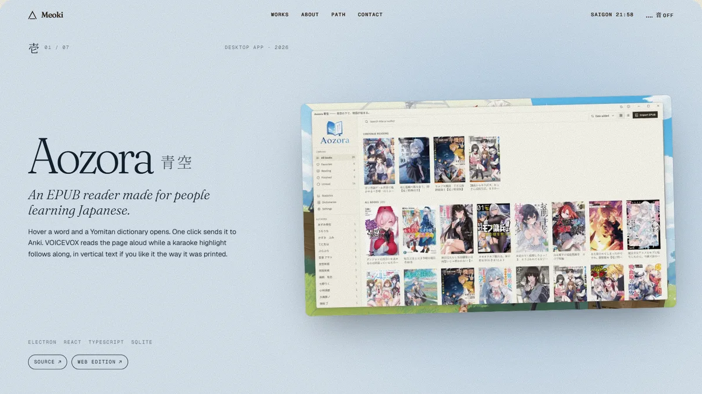
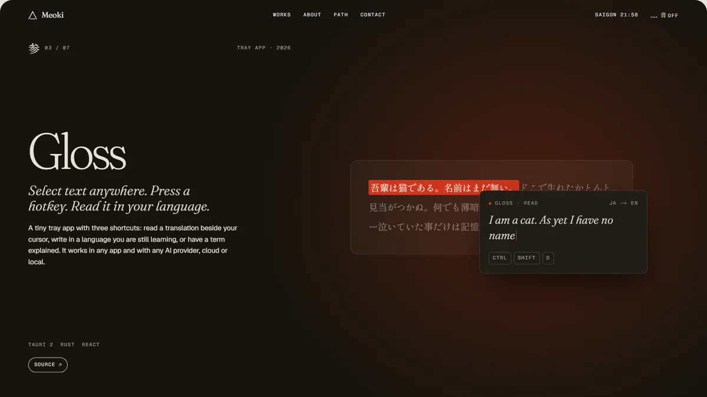
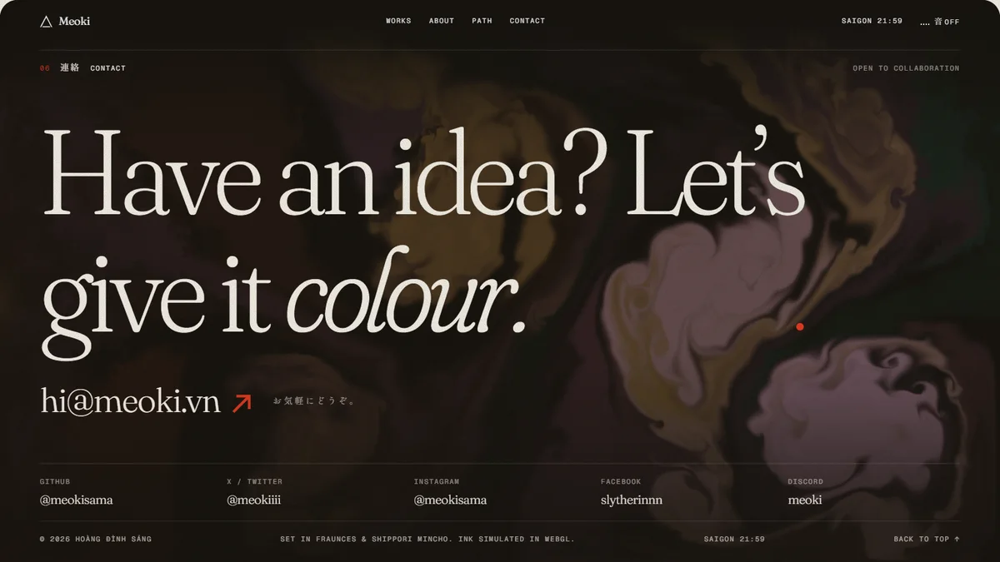
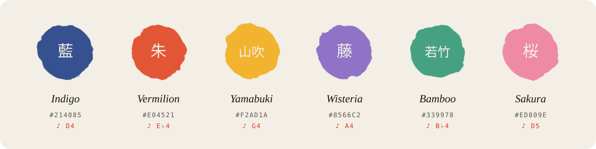

<div align="center">

<a href="https://meoki.vn"></a>

# Meoki

**音を見て、色を聴く。**<br>
<em>I see sound and hear colour.</em>

<sub>PORTFOLIO &nbsp;·&nbsp; 第三版 &nbsp;·&nbsp; 2026</sub>

<br>

<a href="https://meoki.vn"></a>


<br><br>

<a href="https://meoki.vn"></a>

</div>

<br>

## 序 &nbsp;·&nbsp; The idea

A single page, set like a Japanese book: washi paper, mincho type, a vermilion seal in the margin, and ink that moves when you do.

The line on the cover is the brief. **Seeing sound** became a fluid simulation you can stir with the cursor. **Hearing colour** became a note for every ink. Everything else stays quiet so those two things can be loud.

<br>

## 壱 &nbsp;·&nbsp; A look inside

<table>
  <tr>
    <td width="50%"></td>
    <td width="50%"></td>
  </tr>
  <tr>
    <td align="center"><sub><b>About</b> &nbsp;·&nbsp; words that ink themselves in as you scroll</sub></td>
    <td align="center"><sub><b>Works</b> &nbsp;·&nbsp; every project is a sheet laid on the last</sub></td>
  </tr>
  <tr>
    <td width="50%"></td>
    <td width="50%"></td>
  </tr>
  <tr>
    <td align="center"><sub><b>Illustration</b> &nbsp;·&nbsp; no screenshot? draw it in CSS</sub></td>
    <td align="center"><sub><b>Contact</b> &nbsp;·&nbsp; the same ink, rendered as light</sub></td>
  </tr>
</table>

<br>

## 弐 &nbsp;·&nbsp; Six inks, six notes

<div align="center">
  
</div>

<br>

Turn on **音** in the header and each colour plucks its own note from the miyako-bushi scale, the one a koto is tuned to. Drop ink quickly and you are playing something.

<br>

## 参 &nbsp;·&nbsp; What it is made of

<table>
  <tr>
    <td width="26%"><b>Ink you can touch</b></td>
    <td>A stable-fluids solver written straight on WebGL2, with no three.js in between. On paper the dye is pigment: it absorbs light, pools at its edges and catches on the tooth of the page. In the footer the same solver renders it as light on black.<br><sub><code>lib/fluid.ts</code></sub></td>
  </tr>
  <tr>
    <td><b>Colour you can hear</b></td>
    <td>A small plucked voice on Web Audio with a soft delay. Off by default, because nobody likes a website that starts singing.<br><sub><code>lib/sound.ts</code></sub></td>
  </tr>
  <tr>
    <td><b>Sheets that stack</b></td>
    <td>Each project is a full-height sheet that settles back and dims as the next one is laid on top.<br><sub><code>components/Stage.tsx</code></sub></td>
  </tr>
  <tr>
    <td><b>Type that arrives</b></td>
    <td>Headlines rise line by line from behind a mask, and long sentences fill with ink as you read them. Scrolling is smoothed by Lenis and choreographed by GSAP.<br><sub><code>components/Stage.tsx</code></sub></td>
  </tr>
  <tr>
    <td><b>Manners</b></td>
    <td>Respects <code>prefers-reduced-motion</code>, falls back to a still wash when WebGL2 is missing, and pauses the simulation whenever it is off screen.<br><sub><code>components/FluidCanvas.tsx</code></sub></td>
  </tr>
  <tr>
    <td><b>One file of words</b></td>
    <td>Projects, archive, toolbox and timeline all live in one place, so editing the site never means touching layout.<br><sub><code>lib/data.ts</code></sub></td>
  </tr>
</table>

<br>

## 肆 &nbsp;·&nbsp; The paper it is printed on

| | Name | Value | Used for |
|:-:|:--|:--|:--|
|  | Washi | `#f3efe6` | The page |
|  | Sumi | `#17140f` | Text, and the night side |
|  | Shu | `#d9381e` | The seal, the cursor, every accent |

**Type** &nbsp; Fraunces for display, Shippori Mincho for Japanese, Geist and Geist Mono for everything small.

<br>

## 伍 &nbsp;·&nbsp; Run it

```bash
npm install
npm run dev
```

```
app/           layout, global styles, icon and social images
components/    Stage (motion), Sections, Chrome (nav, cursor, preloader), FluidCanvas
lib/           fluid.ts (ink), sound.ts (notes), data.ts (words)
public/works/  project screenshots
```

Pushing to `master` deploys to [meoki.vn](https://meoki.vn) on Vercel.

<br>

<div align="center">

<sub>Set in Fraunces and Shippori Mincho &nbsp;·&nbsp; Ink simulated in WebGL &nbsp;·&nbsp; Made in Saigon</sub>

**好きこそ物の上手なれ。**<br>
<sub><em>What you love, you get good at.</em></sub>

</div>
